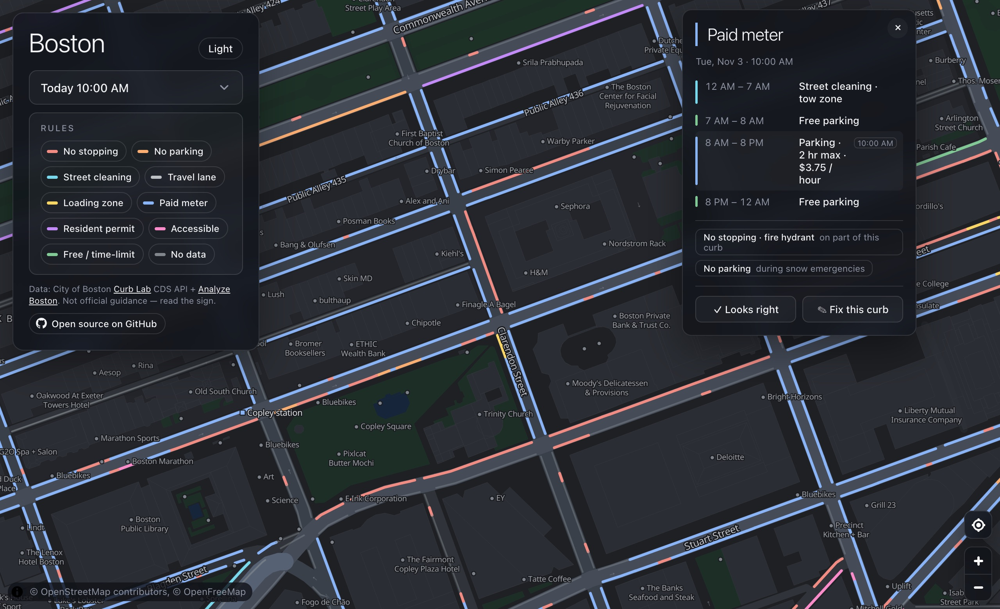
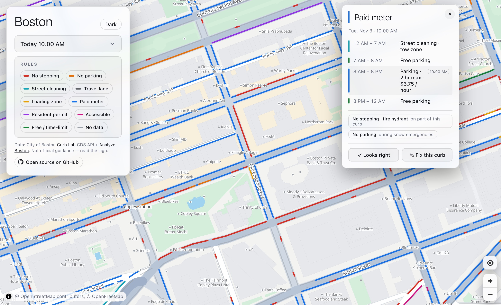
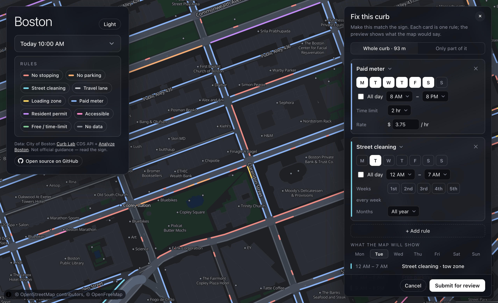
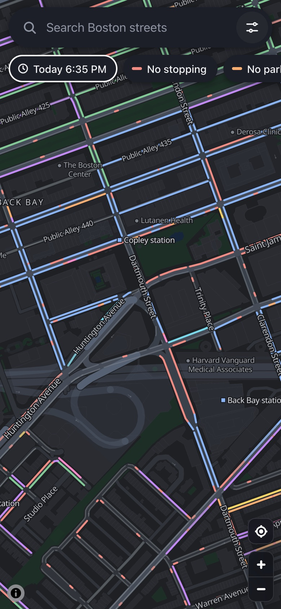

# Boston Curb Map

**Where can I park, right now?** A map of every curb in Boston, colored by the parking rule that applies at the time you pick.

**[boston-curb-map.vercel.app](https://boston-curb-map.vercel.app)**



## What you can do

- **See the rules at a glance.** Every curb is colored by the rule in force: paid meter, free, resident permit, loading, street cleaning, no parking, no stopping. The map follows the clock; pick another day or drag the time slider to plan ahead.
- **Tap a curb to see its whole day.** A timeline of the day ("12–7 AM street cleaning, tow zone · 8 AM–8 PM paid, 2 hr max, $3.75/hr · free after 8 PM"), why a curb is off-limits (fire hydrant, bus stop, tow-away), and anything that applies on other days or only during snow emergencies.
- **Find a street.** Search any Boston street or place, and filter the map to just the rules you care about.
- **Fix what's wrong.** Signs change and records are imperfect. Tap **Fix this curb**, make the rules match the sign (for the whole curb or just part of it), add a photo if you like, and submit. Others can confirm what they see; a moderator reviews every correction before it reaches the map.
- **Use it on your phone.** A search bar and swipeable rule chips up top, settings and curb details in bottom sheets.

| | |
|---|---|
|  |  |

<p align="center"></p>

> Not official guidance. Always read the posted sign. Not affiliated with the City of Boston.

## Where the data comes from

- **City of Boston [Curb Lab](https://www.boston.gov/curb-lab):** every curb segment and its posted rules, from the city's public [Curb Data Specification](https://github.com/openmobilityfoundation/curb-data-specification) feed.
- **[Parking meters](https://data.boston.gov/dataset/parking-meters)** (Analyze Boston): each meter's paid hours, time limit, and tow-away hours.
- **[Street sweeping schedules](https://data.boston.gov)** (Analyze Boston): which side of which block is swept, and when.
- **[OpenStreetMap](https://www.openstreetmap.org) / [OpenFreeMap](https://openfreemap.org):** the basemap, street names and house numbers.
- **People using the map:** corrections, once a moderator accepts them.

The data is refreshed every time the site is deployed.

## How it works

- **Curbs are rebuilt at deploy time.** A build step downloads the city's curb feed, the meters and the sweeping schedules, merges them, and bakes everything into static map tiles. The live site is static files plus a few small API functions for corrections.
- **Curbs are drawn on the streets.** The city records where the physical curb is; the map draws roads at a stylized width. Each curb is matched to the street it runs along and drawn at that street's edge, and trimmed back where it meets a cross street.
- **Meters fill in the gaps.** The city's curb records often list every sign on a block together, so one hydrant could paint a whole metered block red. Each meter is matched to the curb it stands on; its schedule becomes that curb's paid hours, and signs that can only cover part of the curb (a hydrant, a bus stop, a loading zone) are listed in the popup instead of coloring the whole block.
- **Rules are graded in your browser.** When you change the time, the browser works out every curb's rule for that moment (lowest-priority-number rule wins, as in the city's data; meters are free on Sundays and City holidays) and recolors the map without reloading anything.
- **Corrections are reviewed and logged.** Corrections are stored in Supabase as pending. Moderators work through them in a panel on the map itself (the inbox button above "find my location", or `/review`, asks for the admin token): picking a request highlights its curb, with current and proposed rules side by side, and they accept or reject it; accepted corrections are merged into the next build. Every submission, confirmation and decision is written to an append-only log.

## Run it yourself

```bash
npm install
npm run data       # download the city data and build the map tiles (a few minutes)
npm run dev        # http://localhost:5173
```

Corrections need a backend. Copy your Supabase details into `.env.local` (see below), run `supabase db push` to create the tables, and start the API alongside Vite:

```bash
node scripts/dev-server.js --port 3000   # serves /api; Vite forwards /api to it
```

`npm test` builds the site and runs the test suite (rule engine, data pipeline, curb snapping, corrections API, end-to-end against a mock city API). `npm run audit` reports curbs that would be drawn badly (through buildings, off the road, into cross streets).

## Deploy

The site deploys to Vercel. The build (`npm run build`) fetches fresh data, so every deploy is up to date.

| Variable | | Used for |
|---|---|---|
| `SUPABASE_URL` | config | corrections |
| `SUPABASE_SECRET_KEY` | secret | corrections (server only, never sent to the browser) |
| `ADMIN_TOKEN` | secret | moderating corrections (the panel at `/review`) |
| `DEPLOY_HOOK_URL` | secret, optional | a Vercel deploy hook, so accepting a correction rebuilds the map right away |
| `IP_SALT` | secret, optional | salting the network fingerprint used for rate limits |

Without the Supabase variables the map works normally; only corrections are unavailable. For a nightly data refresh, point any scheduler at a Vercel deploy hook.

## Project layout

```
index.html, src/       the map: MapLibre, rule engine (src/rules.js), correction editor (src/editor.js), moderator panel (src/moderation.js)
api/                   Vercel functions: corrections (submit, curb, confirm, review) and a live-data fallback
scripts/               the data build: fetch city data, snap curbs to streets, meters, sweeping, corrections, tiles
supabase/migrations/   database tables for corrections
test/                  tests
```

## Contributing

Issues and pull requests are welcome. If a curb is wrong, the quickest fix is **Fix this curb** on the map. For code changes, `npm test` should pass.
