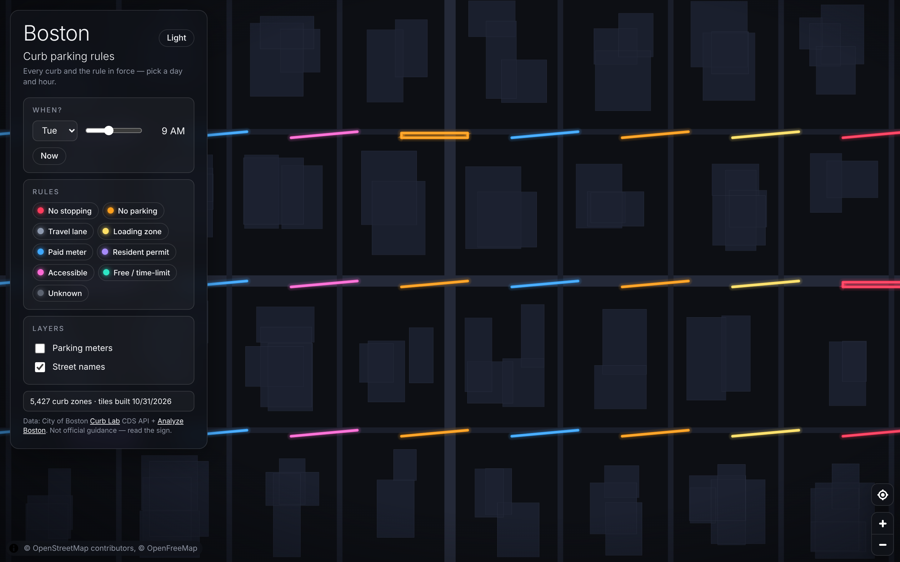
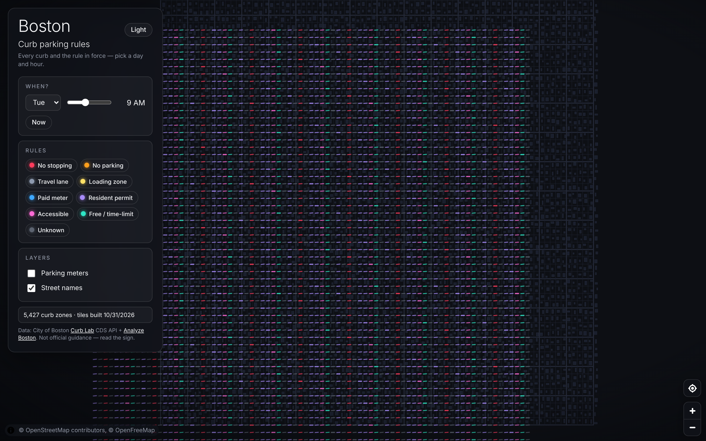
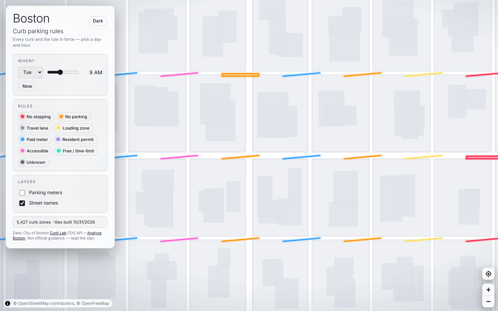

# Boston curb parking rules




*Preview shot against the mock city API with stand-in buildings; live, the towers are real OpenFreeMap footprints with heights and the curb lines follow actual street edges.*

An interactive map of **every curb in Boston and the parking rule that applies** — right now, or at any day/hour you pick.

Live data comes from the City of Boston's [Curb Lab](https://www.boston.gov/curb-lab), which publishes a public [Curb Data Specification](https://github.com/openmobilityfoundation/curb-data-specification) (CDS) feed at `https://cds-curb-api.boston.gov`. Parking meters come from the City's [ArcGIS Hub Parking Meters item](https://bostonopendata-boston.opendata.arcgis.com/datasets/parking-meters/api).

[](https://vercel.com/new/clone?repository-url=https%3A%2F%2Fgithub.com%2Falandev05%2Fboston-curb-map)

## How it works

**Build time** (`npm run build` → `scripts/data.js`):

```
cds-curb-api.boston.gov ──▶ scripts/fetch-cds.js ──▶ data/raw/zones.geojson + policies.json
ArcGIS Hub (Parking Meters) ──▶ scripts/fetch-meters.js ──▶ data/raw/meters.geojson
                              scripts/build-tiles.js ──▶ public/tiles/{z}/{x}/{y}.pbf  (gzipped MVT, z9–15)
                                                         public/data/policies.json, manifest.json
```

Every curb gets a precomputed **168-character weekly schedule** (`sched`, one letter per hour, Mon–Sun) baked into the tile. The map colours curbs with `["slice", ["get","sched"], i, i+1]` — changing the hour is one `setPaintProperty`, ~1 ms, no data touched. City-scale tiles (z9–11) carry only the dominant category so the whole-Boston tile stays ~30 KB per 5k zones. Meters are a point layer in the same tiles from z13.

**Run time**: static files only. The `api/` functions remain as a fallback (`/api/zones`, `/api/policies`, `/api/meters`) and the client uses them automatically when no `manifest.json` exists.

**Freshness**: data is re-fetched on every deploy; `.github/workflows/refresh.yml` hits a Vercel Deploy Hook nightly (set the `VERCEL_DEPLOY_HOOK` secret).

* **Fallback (API) mode**: below z13 one citywide `lite=1` fetch draws the whole city; above it, per-viewport full-detail fetches.
* **Policies** are resolved client-side in `src/rules.js`: for the chosen day + hour, every policy attached to a zone is checked against its CDS `time_spans`; the lowest `priority` number wins (CDS precedence), and its first rule is bucketed into a colour category (no stopping, no parking, travel lane, loading, paid, resident, accessible, free).
* If the city API is unreachable the map falls back to a few hand-made demo curbs in Back Bay and says so in the status chip.

## Run locally

```bash
npm install
npx vercel dev      # serves the site AND the /api functions on :3000
# or: npm run dev   # vite only; proxies /api to :3000 (run vercel dev alongside)
```

## Deploy

Click the Vercel button above, or:

```bash
npx vercel --prod
```

No environment variables required. Set `CDS_BASE` if the city moves the API.

## Project layout

```
api/        Vercel serverless functions (CDS + CKAN proxies)
src/        Vite front-end: MapLibre map, rule resolver, cartoon CSS
index.html  Panel + legend + time picker
```

## Caveats

* Curb Lab coverage started in Chinatown and is expanding citywide — some neighbourhoods may still be empty.
* Category bucketing is a heuristic over CDS `activity` / `user_classes` / `rate`; read the sign before you park.
* Not affiliated with the City of Boston.

## Testing

```bash
npm test          # builds the site, then 113 tests: rule engine, API handlers (mocked fetch), HTTP end-to-end
npm run test:unit # just the fast ones
```

`test/e2e.test.js` boots `scripts/mock-cds.js` (a fake `cds-curb-api.boston.gov` + CKAN with ~5,000 generated curb zones across Boston) and `scripts/dev-server.js` (mounts `api/*.js` without Vercel), then hits them over real HTTP.

### Localhost without Vercel

```bash
# terminal 1 — fake city API + Hub (offline / deterministic)
npm run mock
# terminal 2 — build tiles from the mock, then serve
npm run data:mock && npm run dev:local        # http://localhost:3000

# or against the real city API:
npm run build && npm run serve
```

## Themes

Dark by default (or follows `prefers-color-scheme`); the toggle persists in `localStorage`. The map is strictly 2D (pitch and rotation locked, like Google Maps). Both themes share one layer list so `map.setStyle(…, { diff: true })` swaps paint in place. UI uses the system font stack (Helvetica Neue / Segoe / Roboto) — no web fonts, no logos.
